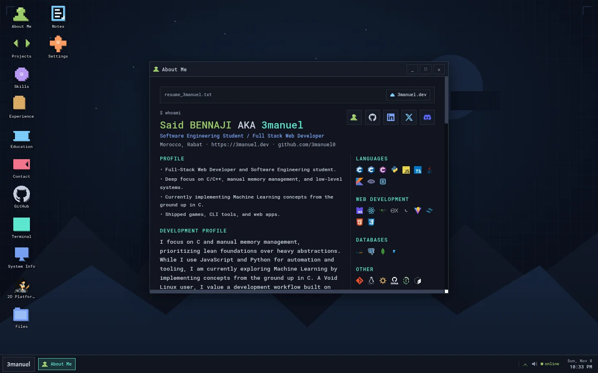

# 3manuel OS — portfolio

[Live site](https://3manuel.dev) · [GitHub](https://github.com/3manuel0) · [LinkedIn](https://www.linkedin.com/in/said-bennaji/)



An interactive Linux-style desktop portfolio for **Said BENNAJI (3manuel)**. It
started as a normal portfolio and grew into a small windowed OS: a terminal with
a virtual filesystem, a project browser, notes, a GitHub dashboard, settings,
and even a little 2D platformer.

The desktop is the main experience. The plain HTML fallback in `index.html`
keeps the portfolio readable for search engines, social previews, and visitors
without JavaScript.

## Features

- Boot screen with skip, first-visit tour, and session memory
- Window manager: drag, resize, maximize, focus, snap-to-grid, taskbar
- Terminal: virtual filesystem, tab completion, `grep`, `tree`, `man`, `uptime`,
  persistent history
- Apps: About, Projects, Skills, Experience, Education, Contact, GitHub,
  Terminal, System Info, Files, Notes, Settings, 2D Platformer
- Phone shell: lock screen, home screen, recents, quick settings, internal back
- Themes: wallpapers, accent palettes, CRT scanlines, invert mode
- Synthesized UI sounds with a volume/mute control
- Static crawlable portfolio fallback, sitemap, robots.txt, JSON-LD, Open Graph
  image, and web manifest
- GitHub API data cached in `localStorage`; a scheduled Action refreshes the
  bundled fallback snapshot

## Stack

- React 18 + TypeScript
- Vite
- Tailwind CSS
- GitHub Pages (deployment)
- GitHub Actions (CI + GitHub snapshot)
- Vitest + Testing Library

## Getting started

```bash
npm install
npm run dev
```

Open the URL printed by Vite. The app is designed for both desktop and phone
layouts; use the Settings app or the right-click menu to switch device mode.

## Scripts

```bash
npm run dev              # local development
npm run build            # type-check + production build
npm run preview          # preview the production build
npm run lint             # ESLint
npm test                 # Vitest
npm run snapshot:github  # refresh src/data/github-*.json
npm run deploy           # build + publish to GitHub Pages
```

## Deployment

The site is deployed to GitHub Pages:

```bash
npm run deploy
```

`public/CNAME` points the site at `3manuel.dev`. The `predeploy` script runs the
production build first.

## GitHub snapshot

The GitHub app tries the live API first, then a cached response, then the bundled
snapshot in `src/data/github-repos.json` / `src/data/github-top-langs.json`.
The snapshot is refreshed daily by `.github/workflows/github-snapshot.yml` and
can be refreshed manually with:

```bash
npm run snapshot:github
```

## Notes

- GitHub API responses are cached in `localStorage` for 6 hours.
- `public/og-image.jpg` is the 1200×630 social preview.
- The interactive desktop is intentionally client-side; the static fallback is
  the crawlable/no-JS version.
- `public/top-languages.svg` is a generated snapshot used outside the app.

## AI assistance

I used AI tools as assistants for parts of the implementation, debugging, and
documentation. The concept, design, content, and final product decisions are
mine, and any mistakes are mine too.
